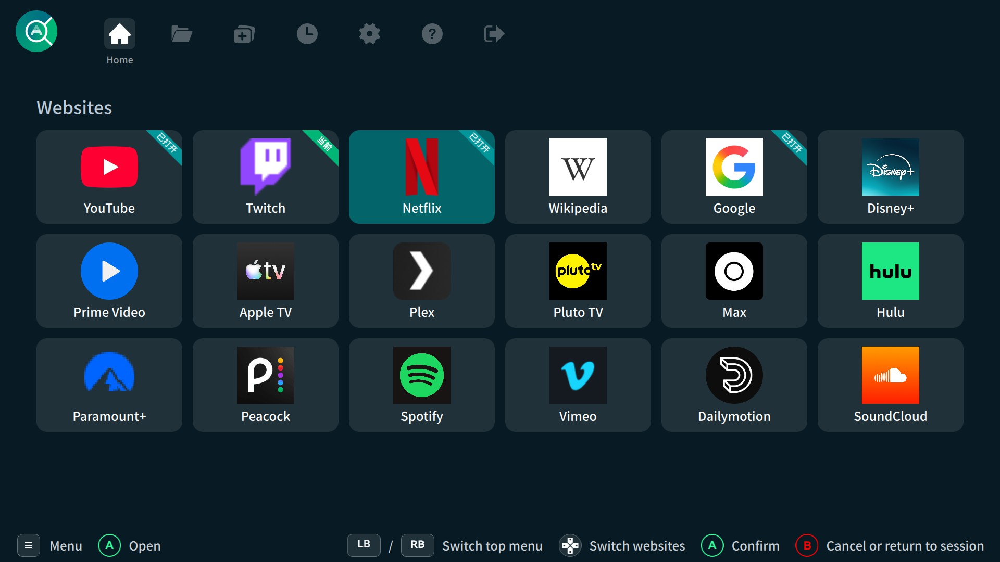
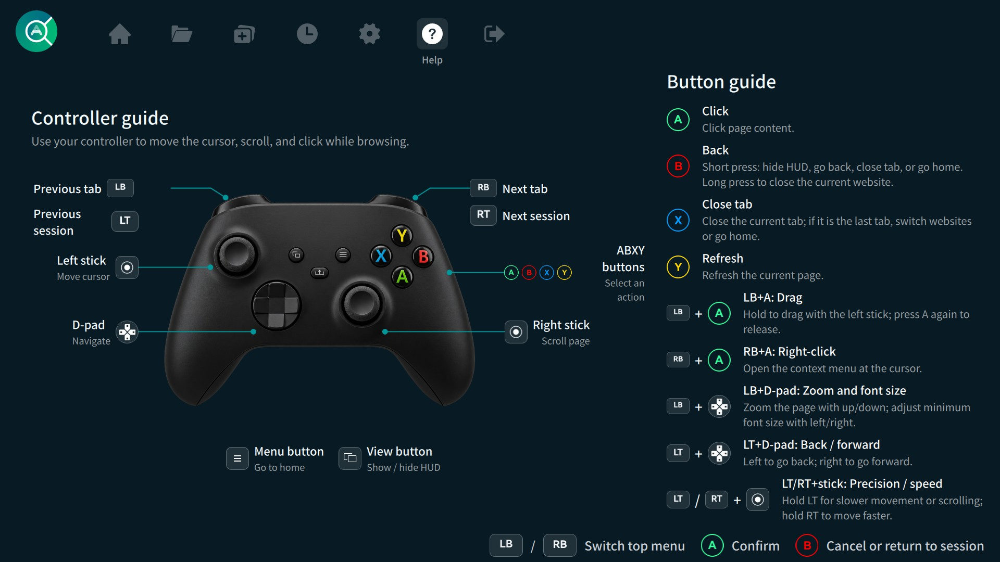

# AeroCore Browser

AeroCore Browser is a controller-first browser for the Gaming Mode of SteamOS-like systems. It uses Qt 6 for the interface, CEF for web pages, and SDL2 for gamepad input. Manage websites as named entries, with related tabs grouped into website sessions. It also supports browsing history and per-site zoom, with a full-screen interface designed for TV and handheld displays.

## Screenshots

### Home and bookmarks



### Controller guide



## Build and run

The target platform is Linux x86_64. Build in Desktop Mode and check focus, cursor, controller, and media behavior in Gaming Mode under gamescope.

If you are building on an immutable system, use the included `distrobox.ini` with [Distrobox](https://distrobox.it/) and Podman or Docker. It provides a Debian 13 environment with Qt 6, SDL2, and the other build dependencies. For other environments, refer to `distrobox.ini` when installing the build dependencies.

Create and enter the container from the project directory. Distrobox obtains the image when it is not already available locally:

```bash
distrobox assemble create
distrobox enter aerocore-browser-dev
```

From the project directory inside Distrobox:

```bash
make
./run.sh --windowed
```

`make` downloads the pinned CEF SDK on the first build. To use an already extracted CEF SDK, set `CEF_ROOT=/absolute/path/to/cef_binary_<version>_linux64` when running `make`.

Launch in Gaming Mode through `run.sh` as a non-Steam game. For packaging and platform-specific build details, see [the build guide](docs/how_to_build.md).

## License

AeroCore Browser source code and project documentation are licensed under the [Mozilla Public License 2.0](LICENSE), unless otherwise noted. Third-party dependencies and assets retain their own licenses.
